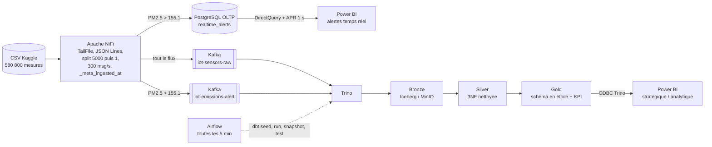

# Plum'Air — Data Lakehouse temps réel pour la surveillance de la qualité de l'air

Preuve de concept réalisée dans le cadre d'un stage à l'**OCP (SBU Mining)** : une plateforme
de données de bout en bout qui simule des capteurs industriels d'émissions, déclenche des alertes
en temps réel et historise les mesures dans un Lakehouse open source (architecture Médaillon).

> Les données sont **publiques** (Kaggle — *Air Quality Dataset: Indian Cities 2022-2025*) et
> servent uniquement à simuler un flux de capteurs. Aucune donnée réelle de l'OCP n'est utilisée.

## Architecture

Architecture **Lambda** : une voie rapide pour l'alerte opérationnelle, une voie analytique
pour l'historique et les KPI de conformité.



| Couche | Rôle | Modèles dbt |
|---|---|---|
| Bronze | Copie brute et immuable des topics Kafka (append, partitionnée par jour) | `bronze_stations_raw`, `bronze_alerts_raw` |
| Silver | Vérité nettoyée et normalisée (3NF) : typage, déduplication, flags de qualité | `silver_station`, `silver_telemetry` |
| Gold | Schéma en étoile (SCD2 sur les stations), conformité CPCB/OMS, KPI mensuels, vue ML | `gold_dim_*`, `gold_fact_*`, `gold_kpi_*`, `gold_ml_features` |

## Stack

| Brique | Version | Rôle |
|---|---|---|
| Apache NiFi | 1.23.2 | Ingestion, simulation du flux OT, routage des alertes |
| Apache Kafka (KRaft) | Confluent 7.4.0 | Bus d'événements et tampon |
| MinIO | RELEASE.2025-09-07 | Stockage objet S3 (bucket `plumair-lake`) |
| Apache Iceberg + PostgreSQL | catalogue JDBC | Format de table ACID, time travel |
| Trino | 483 | Moteur SQL distribué (connecteurs Kafka et Iceberg) |
| dbt-core / dbt-trino | 1.12 / 1.10 | Transformations Médaillon et tests de qualité |
| Apache Airflow | 2.8.2 | Orchestration (DAG `dbt_lakehouse_pipeline`) |
| PostgreSQL | 13 | Base OLTP des alertes temps réel |
| Power BI | Desktop | Restitution |

## Structure du dépôt

```
infrastructure/        docker-compose, configuration Trino, Airflow, NiFi, scripts SQL d'initialisation
ingestion/nifi/        définition exportée du flux NiFi
ingestion/preparation/ préparation du dataset et calibration du seuil d'alerte
plumair_lakehouse/     projet dbt (modèles, seeds, snapshot, tests, analyses)
docs/                  conventions de nommage
data/                  données locales (non versionnées)
```

## Démarrage

1. Télécharger le dataset Kaggle dans `data/raw/new_air_quality_dataset.csv`, puis préparer le
   fichier de simulation et vérifier le seuil :
   ```bash
   python ingestion/preparation/prepare_new_dataset.py
   python ingestion/preparation/compute_alert_threshold.py
   ```
2. Lancer la plateforme :
   ```bash
   cd infrastructure
   docker compose up -d --build
   ```
3. Dans NiFi (https://localhost:8443/nifi), importer `ingestion/nifi/plumair_flow.json`
   (Process Group > Upload). NiFi n'exporte pas les mots de passe : renseigner celui du service
   `PostgreSQL_Ops_Pool` (valeur `POSTGRES_PASSWORD` de `postgres-ops`), activer les services du
   groupe, puis démarrer le flux.
4. Dans Airflow (http://localhost:8081), activer le DAG `dbt_lakehouse_pipeline`.
5. Power BI : source ODBC Trino (`localhost:8080`, catalogue `iceberg`) pour les pages analytiques,
   source PostgreSQL `localhost:5433` / `plumair_ops` en DirectQuery pour la page temps réel.

Les identifiants sont des valeurs de développement définies dans `infrastructure/docker-compose.yml`.

| Interface | URL |
|---|---|
| NiFi | https://localhost:8443/nifi |
| Kafka UI | http://localhost:8082 |
| MinIO | http://localhost:9001 |
| Trino | http://localhost:8080 |
| Airflow | http://localhost:8081 |
| PostgreSQL alertes | localhost:5433 |

## Choix de conception

- **Double horodatage** : `Datetime` (Event Time) vient du capteur, `_meta_ingested_at`
  (Processing Time) est posé par NiFi **après** le contrôle de débit, message par message et à la
  milliseconde. La latence de la voie rapide se lit dans la vue `v_alert_latency` (base `plumair_ops`).
- **Seuil d'alerte** : 155,1 µg/m³, 99e percentile du PM2.5 sur le dataset source complet,
  soit environ 1,4 % du flux simulé (contre 6 % avec un seuil fixe à 100).
- **Incrémental robuste** : Bronze lit Kafka par offset, avec l'horodatage Kafka en filet de
  sécurité si un topic est recréé. Silver et Gold utilisent un watermark temporel avec une minute
  de recouvrement, sans risque de doublon puisque le `merge` est idempotent.
- **Historique** : Bronze est en append et survit à la rétention Kafka. Les tables Iceberg
  permettent le time travel (`plumair_lakehouse/analyses/time_travel_demo.sql`).
- **Qualité** : les valeurs hors plage physique sont mises à NULL avec un flag `*_is_outlier`,
  et 32 tests dbt valident les contrats de données à chaque exécution.
